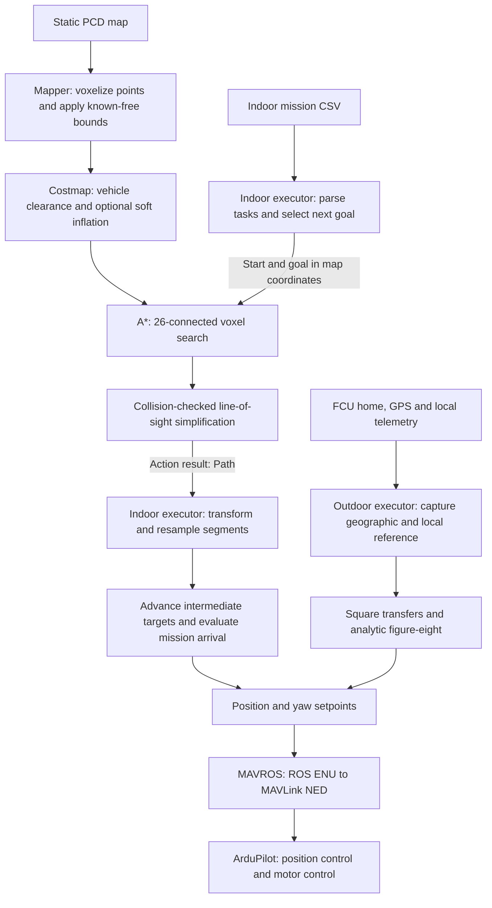
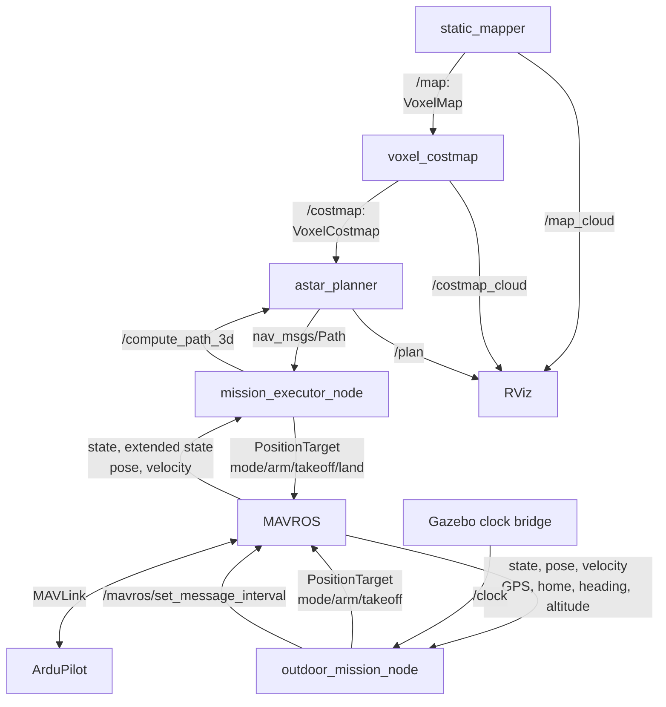

# A1 — Navigation stack: design and defense

This document covers A1.1–A1.3 against the [A1.4 requirements](https://github.com/KocurMaros/LRS-URK/blob/f35c518df2eaf7ee4cca34d1afbeac0734df86f3/assignments/assignment1/04_documentation_and_defence.md).
It describes the current implementation and separates automated checks from flight
evidence. The outdoor mission
recordings are linked in Section 8.
This is the current documentation; earlier specifications and development notes
are archived in [doc/legacy](doc/legacy/).

## 1. System design

The indoor pipeline separates representation, vehicle clearance, search and mission
execution. The map owns spatial geometry; the costmap owns traversability; the
planner owns path search. The mission executor decides when to request a path and
when to advance tasks. Outdoor flight uses an analytic trajectory and geographic
reference rather than the indoor occupancy map.

### Data processing



### ROS interfaces and execution



Indoor state-machine, setpoint and telemetry callbacks use separate callback groups
with a three-thread executor and mutex-protected shared data. The 20 Hz setpoint
timer remains separate from state progression. Planning runs in its own worker,
allowing cancellation and costmap receipt while searching; a request uses a captured
costmap snapshot. The outdoor node uses one executor thread and asynchronous
services: short callbacks do not require application mutexes. It publishes setpoints
at 30 Hz, updates mission state at 10 Hz and reports diagnostics at 1 Hz.

The indoor and outdoor executors are alternative MAVROS command sources and are
run separately. Map/costmap snapshots use reliable transient-local delivery for late
subscribers. The costmap publishes a complete result on accepted changes, not
periodic incremental costmap updates. The planner searches only on action requests;
receiving a new map does not automatically replan or validate an old path.

## 2. Map representation and obstacle clearance

### Sparse fixed-resolution voxels

The map uses 0.2 m cubic voxels grouped into sparse 8 × 8 × 8 blocks. The mapper filters nonfinite PCD points and
marks their voxels occupied. Resolution, origin and frame propagate to downstream
nodes instead of being configured independently.

This representation was chosen over an octree because search, cost lookup and
clearance operations all benefit from a uniform metric grid. Sparse blocks avoid allocating
the entire surrounding world while keeping indexing straightforward. An octree
could compress large homogeneous volumes further, but introduces variable-depth
traversal and neighbour handling. The 0.2 m resolution is a practical starting
compromise between indoor detail, search size and memory; it has not been selected
through a resolution-versus-flight-accuracy experiment. Thin or poorly sampled
geometry can still be missed.

An empty PCD region is not evidence of free space. The mapper explicitly declares
the configured box `[0, 0, 0]`–`[15, 12, 6]` m known free before inserting obstacles.
Outside represented known space, voxels remain unknown and are blocked for planning.
The box is an assumption about the complete static environment, not a sensor-derived
free-space observation; mission endpoints must lie inside it.

### Inflation

Costs follow the familiar occupancy convention: 0 free, 1–252 soft cost, 253 blocked
clearance, 254 measured obstacle and 255 unknown. Clearance uses a spherical vehicle
approximation in 3D:

```text
blocked clearance = vehicle_radius + position_tolerance + safety_margin
total reach       = blocked clearance + inflation_radius
```

`inflation_radius` is the width added beyond clearance. Within clearance, motion is
blocked; the optional outer band has exponentially decaying costs. A cached stencil
applies these distances around occupied voxels, retaining the greatest cost from
overlapping obstacles. Full rebuilds favour simple, reproducible behaviour over
incremental-update complexity, at the expense of processing time on larger maps.

Current `costmap.yaml` values are **0.30 + 0.10 + 0.25 = 0.65 m blocked clearance**
and **0.0 m soft width**. Thus the current configuration has no traversable soft
inflation band - it was removed to allow better visualization of the interior space in rviz. 

Inflation is intended to close narrow gaps in the rack point cloud. No explicit
solid-shelf filling is implemented. Shelf clearance remains the developer's visual
evaluation against Gazebo collision volumes; point-cloud collision freedom alone
does not establish that the configured clearance closes unsafe shelf gaps.

## 3. Planning and path post-processing

The planner uses 3D A* with 26 neighbours, allowing simultaneous movement along
multiple axes. Edge length is Euclidean; a nonnegative penalty from the endpoint
voxel costs discourages soft inflation. The heuristic is Euclidean distance to the
goal voxel centre. It never exceeds the remaining grid cost, so completed search
finds an optimal route for this discrete graph and cost model. Search limits can
instead return failure.

A* was chosen over sampling methods because this bounded static environment already
has a voxel grid and benefits from deterministic connectivity and explicit failure
reporting. Its drawback is rapidly increasing search size as resolution becomes
finer. Compared with Theta*, it keeps search simpler and moves straight-line
refinement into a separate step. Diagonal edges are collision checked to prevent
cutting through blocked corners. Current limits are 200,000 expansions, 500,000
search nodes and 10 seconds per request.

Post-processing greedily connects each retained point to the farthest later point
visible through traversable voxels. Conservative voxel traversal checks touched
cells; the final segments are checked again. This removes grid stair steps and
reduces the number of control targets. It preserves collision freedom in the
captured costmap, but it does not preserve the A* weighted-cost optimum: a shortcut
can pass nearer an obstacle through traversable soft costs. It also cannot guarantee
the physical vehicle follows the geometric line exactly.

Real-map pipeline measurements recorded during development were:

| Route, map coordinates in metres | Raw → refined points | Reported planning time |
|---|---:|---:|
| (13.6, 1.5, 1.0) → (8.65, 2.02, 1.0) | 27 → 2 | about 1.1 ms |
| (8.65, 2.02, 1.0) → (4.84, 5.37, 2.0) | 27 → 3 | about 5.8 ms |

These are individual measurements on the development machine at 0.2 m resolution,
with the earlier 0.5 m clearance / 0.8 m absolute outer-radius configuration.
Inflation semantics and tuning have since changed.

## 4. Indoor mission execution and heading

The CSV describes position, `hard`/`soft` precision and optional takeoff, landing,
landing/relaunch or absolute-yaw tasks. An explicit C++ state machine manages MAVROS
connection, GUIDED mode, arming, navigation and tasks. This keeps transitions and
failure handling visible in ordinary source code. FlexBE was considered and
installed, but the current mission executors do not depend on it.

The position controller is an arrival supervisor; ArduPilot closes the position,
attitude and motor-control loops. A soft waypoint completes within **0.50 m** without
a stopping requirement. A hard waypoint requires **0.15 m** position error and speed
at most **0.15 m/s**, continuously for **1 second**. These values distinguish
pass-through points from deliberate task stops. They are configurable through `hard_tolerance_m`, `soft_tolerance_m`,
`hard_speed_limit_mps` and `hard_stable_time_s`.

The A* result is transformed to MAVROS local coordinates and each straight segment
is resampled with default spacing at most 0.50 m (`task_path_resample_spacing_m`). Intermediate targets advance on proximity,
without a zero-speed or dwell requirement. The default distance threshold is 0.20 m;
original line-of-sight bends use at most 0.10 m to reduce corner shortcuts. Final
mission waypoints use the hard/soft arrival policy. Dense targets do not constitute
a dynamically feasible trajectory or eliminate controller corner-cutting; inspect
actual flight clearance as well as the planned line.

Between mission waypoints, yaw faces the horizontal travel direction using
`atan2(dy, dx)`; vertical-only motion retains yaw. The indoor task logic aligns heading
before translation, and explicit yaw tasks hold position. Planned-route bends can
also require heading realignment. Equivalent angles are chosen near measured yaw:

```text
yaw_command = yaw_measured + remainder(yaw_desired - yaw_measured, 2π)
```

This avoids a full-turn discontinuity across ±π. Absolute CSV yaw is interpreted in
ENU degrees. The prototype map-to-MAVROS transform is a fixed rotation
`(x_local, y_local, z_local) = (-y_map, x_map, z_map)`, rather than a general TF lookup.
This matches the current simulator convention and must be verified independently
for another world or vehicle.

Configure MAVROS local-position telemetry to use `mavros_local`. Run the static
TF publisher below to publish a zero-translation, −90° yaw transform
from `map` to `mavros_local`. In RViz, Fixed Frame `map` therefore aligns odometry
with the plan. The executor still converts target coordinates explicitly; TF is
not a second rotation of the flight commands. Start MAVROS separately with the
repository script before launching the mission.

An optional dynamic start performs a vertical ascent at measured ground XY, then
plans to CSV waypoint 1 before continuing the mission. It is not an airborne
restart, and A* does not check the vertical ascent column. It requires explicit
`enable_dynamic_start` and `dynamic_start_clearance_confirmed` parameters in
addition to confirmed planned flight. The manual command below enables dynamic
start. A previously completed seven-waypoint simulation included yaw tasks,
landing/relaunch and final ground-confirmed disarm; repeat evidence should identify
the exact revision and configuration used.

## 5. Outdoor reference, yaw and trajectory

GeographicLib `LocalCartesian` converts WGS84 latitude, longitude and ellipsoid
altitude to a local tangent ENU frame through Earth-centred coordinates. It avoids
handwritten latitude/longitude scaling and handles both directions consistently.
The reference is captured from FCU home, or a qualified GPS-fix fallback; launch
position is captured separately. Translation and a configured yaw offset map mission
ENU into MAVROS local coordinates. Freezing these values avoids continuously moving
mission goals with GPS noise, but estimator resets or an incorrect initial reference
can invalidate the alignment.

Geodetic round-trip tests recover local points within 1e-7 m. This measures numerical
consistency, not GPS accuracy or Earth-curvature modelling error. The tangent-plane
curvature scale over 10 m is approximately `d²/(2R) ≈ 8 µm`, which is  negligible. Ellipsoid altitude is used for geographic conversion; AMSL and
home/launch-relative altitude are not interchangeable.

ROS-side positions and yaw use ENU: east, north, up; yaw zero east, positive
counterclockwise. Compass heading is degrees clockwise from north, converted by
`yaw_ENU = π/2 − heading × π/180`. MAVROS converts ROS local setpoints to MAVLink NED
and returns FCU telemetry in ROS conventions. The `FRAME_LOCAL_NED` enum in
`PositionTarget` does not require the application to swap its ROS ENU coordinates.
We command fused local-pose yaw, not raw compass readings.

The outdoor mission takes off to 5 m above launch, flies four configured square
corners and returns to the first, stops at each corner, then moves above the POI
and aligns to the figure-eight's initial tangent. GPS is the default coordinate
mode: four ordered `[latitude, longitude]` corner pairs and an explicit GPS POI
are converted once into the captured local reference. The POI also defines the
figure-eight centre. Altitude remains launch-relative. ENU mode retains a 5 m
square centred at offsets `poi_east=2.5`, `poi_north=2.5` metres. The envelope uses
actual selected corners in either mode. Square yaw
continuously faces the POI from measured position. Transfers interpolate position
at 1 m/s; repeated final setpoints provide a settling hold.

For one figure-eight lap, with centre `(E₀, N₀)`:

```text
E(t) = E₀ + A sin(ωt)
N(t) = N₀ + A sin(ωt) cos(ωt)
vE(t) = Aω cos(ωt)
vN(t) = Aω cos(2ωt)
yaw(t) = atan2(vN(t), vE(t)), unwrapped continuously
```

With **A = 3 m** and **ω = 0.2 rad/s**, one lap takes **31.42 s** and peak reference
speed is **Aω√2 = 0.849 m/s**, below the configured 1.5 m/s limit. An analytic curve
gives continuous time-based position and tangent yaw without a stored waypoint list;
its limitation is that tracking is left to ArduPilot rather than optimized against
vehicle dynamics or obstacles.

For the original 5 m layout with launch at the mission origin, a conservative horizontal bound is the greater
of the square's farthest corner (7.07 m) and the figure-eight bounding rectangle
(6.80 m). Including the 0.5 m margin gives 7.57 m, inside the 10 m mission bound.
The 5 m launch-relative height plus margin fits the 6 m vertical bound. The code
recomputes the horizontal bound from the captured launch offset: an offset launch
must not be assumed to have the same clearance. These are application envelope
checks, not confirmation of an enabled ArduPilot geofence. After one lap the vehicle
settles, returns to launch, requests LAND and disarms only with ground confirmation.

## 6. Timing, faults and known limitations

Outdoor telemetry ages, readiness dwell, arrival dwell and trajectory progress use
ROS time. The simulation launch bridges Gazebo `/clock` and enables simulation time;
service deadlines and the clock-stall watchdog use steady wall time. A backward
clock reset releases active control. The indoor implementation still uses wall-time
telemetry and arrival checks: slow Gazebo can fail preflight despite valid simulated
motion. Its slow-SITL profile relaxes timing, with a configurable motion-sample window.
An earlier run at approximately 0.79 Hz motion and 0.2 Hz state demonstrated why
telemetry rates and simulation speed must be checked. Indoor clock-policy changes
are not required to reproduce the accepted outdoor behaviour.

Outdoor explicit abort or navigation faults request LAND while connected and owning
GUIDED. Connection loss or mode override stops setpoints and releases control rather
than taking it back. Landing/disarm failure reports failure without forced in-air
disarm. Late command responses are ignored after a mission-phase change. Landed-state
telemetry is requested once through MAVROS (message 245 at 2 Hz); rejection or response
timeout prevents startup. GPS/local-position and compass/local-yaw disagreements
are diagnostic information, not automatic mismatch-triggered landing commands.

Sensor robustness was qualitatively tested. Earlier saved SITL settings
selected simulator state (`AHRS_EKF_TYPE=10`); a later snapshot selected EKF3
(`AHRS_EKF_TYPE=3`, `EK3_ENABLE=1`). GPS-altitude disturbance (`SIM_GPS1_NOISE=2`) and barometer-noise
tests produced no visible flight change; raw sensor changes and quantitative
errors were not verified.

The developer accepted these observed SITL responses: reducing satellite count
below the configured minimum caused landing; stopping MAVROS caused
`RELEASE_CONTROL` with the vehicle remaining airborne; stopping the mission node
left the vehicle holding in the air. Automatic landing on mission-process exit is
not required for this setup. Setpoint cadence was also checked and accepted,
without recorded worst-case callback duration or jitter measurements. These results
are not guarantees under complete link loss or estimator failure. Real-flight
transport, calibration, frame alignment and onboard failsafes remain separate work.

## 7. Build and run

### Dependencies and build

The workspace targets Ubuntu 24.04 and ROS 2 Jazzy. Simulation additionally needs
Gazebo, a matching `ardupilot_gazebo` plugin build, ArduPilot SITL and MAVROS.
C++ dependencies include GeographicLib and PCL; ROS runtime dependencies include
`ros_gz_bridge` and `tf2_ros`. MAVROS also requires GeographicLib datasets. Keep
MAVROS, `libmavconn` and `mavros_msgs` on compatible versions: a mixed installation
previously caused a startup symbol-lookup failure. FlexBE is not required.

From `ros2_ws`:

```bash
source /opt/ros/jazzy/setup.bash
rosdep install --from-paths src --ignore-src -r -y
colcon build
source install/setup.bash
colcon test
colcon test-result --verbose
```

Source ROS and this workspace's `install/setup.bash` in every ROS terminal. Use
absolute mission/map paths when starting from another working directory. Repository
simulation scripts are one level above this workspace, in `../scripts/`.

### Indoor mission

Start each long-running component in a separate terminal from `ros2_ws`:

```bash
../scripts/run_gazebo.sh
../scripts/run_sitl.sh
../scripts/run_mavros.sh
```

Then start mapper, costmap and planner in separate sourced terminals:

```bash
ros2 launch mapper mapper_launch.py map_file:=/absolute/path/to/map.pcd
ros2 launch voxel_costmap costmap_launch.py
ros2 launch astar_planner planner_launch.py
```

The mission is `/home/user/LRS-URK/missions/exam_example.csv`. With MAVROS
connected and the UAV on ground/disarmed, run the executor manually from `ros2_ws`:

```bash
ros2 run mission_executor mission_executor_node --ros-args \
  --params-file "$PWD/src/mission_executor/config/mission_executor.yaml" \
  -p mission_file:=/home/user/LRS-URK/missions/exam_example.csv \
  -p mavros_frame:=mavros_local \
  -p enable_task_sequence_check:=false \
  -p enable_task_flight:=true \
  -p task_flight_confirmed:=true \
  -p task_slow_sitl_telemetry:=true \
  -p enable_task_planned_flight:=true \
  -p task_planner_frame_confirmed:=true \
  -p task_planned_max_z_m:=4.0 \
  -p task_path_point_tolerance_m:=0.50 \
  -p enable_dynamic_start:=true \
  -p dynamic_start_clearance_confirmed:=true
```

For RViz during a manual run, publish the static transform in another terminal:

```bash
ros2 run tf2_ros static_transform_publisher \
  --x 0 --y 0 --z 0 \
  --yaw -1.57079632679 --pitch 0 --roll 0 \
  --frame-id map --child-frame-id mavros_local
```

If landed-state telemetry
is missing, request it after FCU connection:

```bash
ros2 service call /mavros/set_message_interval mavros_msgs/srv/MessageInterval \
  '{message_id: 245, message_rate: 2.0}'
```

Use RViz Fixed Frame `map`, `/plan`, `/map_cloud`, `/costmap_cloud` and
`/mavros/local_position/odom`. The static transform assumes coincident origins
and the executor's fixed map-to-local rotation. Indoor automatic error-landing is an opt-in
feature, disabled by default; it requires separate clearance confirmation.

### Outdoor mission

Use [config/outdoor.yaml](src/mission_executor/config/outdoor.yaml) to select
coordinates and limits. The committed GPS corners/POI are near the hangar home
**48.15084570555732, 17.072729745416016**, as used in the accepted runs. They must
match the SITL geographic origin; the outdoor world file's example geographic
location is different. From `ros2_ws`, in separate terminals:

```bash
../scripts/run_gazebo.sh fei_lrs_outdoor.world
HOME_LOCATION=48.15084570555732,17.072729745416016,150,0 ../scripts/run_sitl.sh
../scripts/run_mavros.sh
```

Restart/reconfigure MAVROS after an indoor run so the earlier frame-label settings
do not carry over unintentionally. Preview and then explicitly enable flight:

```bash
ros2 launch mission_executor outdoor_sim.launch.py
# After checking telemetry, GPS corners/POI and the reported envelope:
ros2 launch mission_executor outdoor_sim.launch.py enable_flight:=true
```

Stop the preview launch before starting the flight launch. The simulation launch
starts the Gazebo-to-ROS clock bridge and enables ROS simulation time. The mapper,
costmap and planner are not needed for this analytic outdoor mission.

```yaml
coordinate_mode: gps  # Default; alternative: enu.
poi_gps: [48.150868185, 17.072763300]
square_corner_1_gps: [48.15089067, 17.07272970]
square_corner_2_gps: [48.15089067, 17.07279690]
square_corner_3_gps: [48.15084570, 17.07279690]
square_corner_4_gps: [48.15084570, 17.07272970]
```

These are `ros__parameters` entries in the configuration file, not a standalone ROS
parameter file. GPS coordinates are absolute WGS84 degrees, with no altitude in
the pairs. ENU mode uses `poi_east`, `poi_north` and `square_side` instead. An
out-of-envelope GPS configuration blocks readiness; increasing the envelope is not
a substitute for correcting mismatched home/corner coordinates.

All outdoor MAVROS topics and services share the configurable `mavros_prefix`,
default `/mavros`. For another existing vehicle interface:

```bash
ros2 launch mission_executor outdoor_sim.launch.py mavros_prefix:=/drone01
```

This redirects the mission interfaces; it does not start or rename MAVROS. Mission
state, diagnostics and abort retain their own names. Abort a running mission with:

```bash
ros2 service call /outdoor_mission/abort std_srvs/srv/Trigger '{}'
```

`execute_square:=false` selects takeoff/return only;
`execute_figure_eight:=false` selects square-only flight. The real-flight launch is
an explicitly unfinished hardware entry point, not a validated deployment.

## 8. Evidence and defense preparation

[Outdoor run recordings — Google Drive](https://drive.google.com/drive/folders/18p4L7dQqtNPm-RtJtOg_cNxpsdhLNMUm?usp=sharing).
