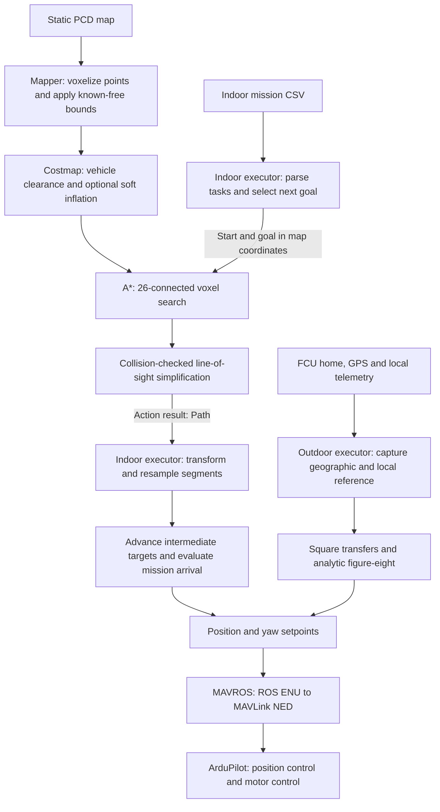
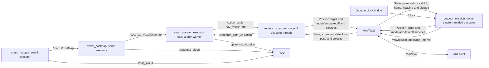

# A1 — Navigation stack: design and defence

This document covers A1.1–A1.3 against the [A1.4 requirements](https://github.com/KocurMaros/LRS-URK/blob/f35c518df2eaf7ee4cca34d1afbeac0734df86f3/assignments/assignment1/04_documentation_and_defence.md).
It describes the current implementation and separates automated checks from flight
evidence. Full indoor flight validation, recordings and noisy-sensor tests remain
TODOs. Outdoor simulation flights have been visually tested and accepted by the
developer; this is not validation on a physical vehicle.

## 1. System design

The indoor pipeline separates representation, vehicle clearance, search and mission
execution. The map owns spatial geometry; the costmap owns traversability; the
planner owns path search. The mission executor decides when to request a path and
when to advance tasks. Outdoor flight uses an analytic trajectory and geographic
reference rather than the indoor occupancy map.

### Data processing



### ROS interfaces and execution



Indoor state-machine, setpoint and telemetry callbacks use separate callback groups
with a three-thread executor and mutex-protected shared data. The 20 Hz setpoint
timer remains separate from state progression. Planning runs in its own worker,
allowing cancellation and costmap receipt while searching; a request uses a captured
costmap snapshot. The outdoor node uses one executor thread and asynchronous
services: short callbacks do not require application mutexes. It publishes setpoints
at 30 Hz, updates mission state at 10 Hz and reports diagnostics at 1 Hz. These are
configured timer rates, not measured guarantees under load.

The indoor and outdoor executors are alternative MAVROS command sources and are
run separately. Map/costmap snapshots use reliable transient-local delivery for late
subscribers. The costmap publishes a complete result on accepted changes, not
periodic incremental costmap updates. The planner searches only on action requests;
receiving a new map does not automatically replan or validate an old path.

## 2. Map representation and obstacle clearance

### Sparse fixed-resolution voxels

The map uses 0.2 m cubic voxels grouped into sparse 8 × 8 × 8 blocks. Signed block
indices support negative coordinates. The mapper filters nonfinite PCD points and
marks their voxels occupied. Resolution, origin and frame propagate to downstream
nodes instead of being configured independently.

This representation was chosen over an octree because search, cost lookup and
clearance operations all need a uniform metric grid. Sparse blocks avoid allocating
the entire surrounding world while keeping indexing straightforward. An octree
could compress large homogeneous volumes further, but introduces variable-depth
traversal and neighbour handling. The 0.2 m resolution is a practical starting
compromise between indoor detail, search size and memory; it has not been selected
through a resolution-versus-flight-accuracy experiment. Thin or poorly sampled
geometry can still be missed.

An empty PCD region is not evidence of free space. The mapper explicitly declares
the configured box `[0, 0, 0]`–`[15, 12, 6]` m known free before inserting obstacles.
Outside represented known space, voxels remain unknown and are blocked for planning.
The box is an assumption about the complete static environment, not a sensor-derived
free-space observation; mission endpoints must lie inside it.

### Inflation

Costs follow the familiar occupancy convention: 0 free, 1–252 soft cost, 253 blocked
clearance, 254 measured obstacle and 255 unknown. Clearance uses a spherical vehicle
approximation in 3D:

```text
blocked clearance = vehicle_radius + position_tolerance + safety_margin
total reach       = blocked clearance + inflation_radius
```

`inflation_radius` is the width added beyond clearance. Within clearance, motion is
blocked; the optional outer band has exponentially decaying costs. A cached stencil
applies these distances around occupied voxels, retaining the greatest cost from
overlapping obstacles. Full rebuilds favour simple, reproducible behaviour over
incremental-update complexity, at the expense of processing time on larger maps.

Current `costmap.yaml` values are **0.30 + 0.10 + 0.25 = 0.65 m blocked clearance**
and **0.0 m soft width**. Thus the current configuration has no traversable soft
inflation band. Older comments describing 0.9 m clearance plus 0.8 m soft width do
not match these values. These settings are engineering starting values, not a
measured vehicle-envelope justification. The costmap's 0.10 m position allowance
also differs from the indoor controller's 0.15 m hard tolerance; reconcile this
against observed tracking error before claiming a guaranteed clearance.

Inflation is intended to close narrow gaps in the rack point cloud. No explicit
solid-shelf filling is implemented. **TODO: visually inspect planned routes against
Gazebo rack collision volumes and confirm that the configured clearance closes
unsafe shelf gaps.** Point-cloud collision freedom alone does not establish this.

## 3. Planning and path post-processing

The planner uses 3D A* with 26 neighbours, allowing simultaneous movement along
multiple axes. Edge length is Euclidean; a nonnegative penalty from the endpoint
voxel costs discourages soft inflation. The heuristic is Euclidean distance to the
goal voxel centre. It never exceeds the remaining grid cost, so completed search
finds an optimal route for this discrete graph and cost model. Search limits can
instead return failure. This is not a claim of continuous-space optimality.

A* was chosen over sampling methods because this bounded static environment already
has a voxel grid and benefits from deterministic connectivity and explicit failure
reporting. Its drawback is rapidly increasing search size as resolution becomes
finer. Compared with Theta*, it keeps search simpler and moves straight-line
refinement into a separate step. Diagonal edges are collision checked to prevent
cutting through blocked corners. Current limits are 200,000 expansions, 500,000
search nodes and 10 seconds per request; these are limits, not expected runtimes.

Post-processing greedily connects each retained point to the farthest later point
visible through traversable voxels. Conservative voxel traversal checks touched
cells; the final segments are checked again. This removes grid stair steps and
reduces the number of control targets. It preserves collision freedom in the
captured costmap, but it does not preserve the A* weighted-cost optimum: a shortcut
can pass nearer an obstacle through traversable soft costs. It also cannot guarantee
the physical vehicle follows the geometric line exactly.

Historical real-map pipeline measurements recorded during development were:

| Route, map coordinates in metres | Raw → refined points | Reported planning time |
|---|---:|---:|
| (13.6, 1.5, 1.0) → (8.65, 2.02, 1.0) | 27 → 2 | about 1.1 ms |
| (8.65, 2.02, 1.0) → (4.84, 5.37, 2.0) | 27 → 3 | about 5.8 ms |

These are individual measurements on the development machine at 0.2 m resolution,
with the earlier 0.5 m clearance / 0.8 m absolute outer-radius configuration.
Inflation semantics and tuning have since changed. **TODO: repeat both routes with
the submitted settings and record hardware, build type and repeated-run timing.**
The action exposes planning time, expanded nodes and raw/refined point counts.

## 4. Indoor mission execution and heading

The CSV describes position, `hard`/`soft` precision and optional takeoff, landing,
landing/relaunch or absolute-yaw tasks. An explicit C++ state machine manages MAVROS
connection, GUIDED mode, arming, navigation and tasks. This keeps transitions and
failure handling visible in ordinary source code. FlexBE was considered and
installed, but the current mission executors do not depend on it.

The position controller is an arrival supervisor; ArduPilot closes the position,
attitude and motor-control loops. A soft waypoint completes within **0.50 m** without
a stopping requirement. A hard waypoint requires **0.15 m** position error and speed
at most **0.15 m/s**, continuously for **1 second**. These values distinguish
pass-through points from deliberate task stops; they remain to be justified against
measured flight error. They are currently constructor values rather than ROS
parameters, so changing them for the defence requires rebuilding.

The A* result is transformed to MAVROS local coordinates and each straight segment
is resampled with spacing at most 0.35 m. Intermediate targets advance on proximity,
without a zero-speed or dwell requirement. The default distance threshold is 0.20 m;
original line-of-sight bends use at most 0.10 m to reduce corner shortcuts. Final
mission waypoints use the hard/soft arrival policy. Dense targets do not constitute
a dynamically feasible trajectory or eliminate controller corner-cutting; inspect
actual flight clearance as well as the planned line.

Between mission waypoints, yaw faces the horizontal travel direction using
`atan2(dy, dx)`; vertical-only motion retains yaw. The indoor task logic aligns heading
before translation, and explicit yaw tasks hold position. Planned-route bends can
also require heading realignment. Equivalent angles are chosen near measured yaw:

```text
yaw_command = yaw_measured + remainder(yaw_desired - yaw_measured, 2π)
```

This avoids a full-turn discontinuity across ±π. Absolute CSV yaw is interpreted in
ENU degrees. The prototype map-to-MAVROS transform is a fixed rotation
`(x_local, y_local, z_local) = (-y_map, x_map, z_map)`, rather than a general TF lookup.
This matches the current simulator convention and must be verified independently
for another world or vehicle.

## 5. Outdoor reference, yaw and trajectory

GeographicLib `LocalCartesian` converts WGS84 latitude, longitude and ellipsoid
altitude to a local tangent ENU frame through Earth-centred coordinates. It avoids
handwritten latitude/longitude scaling and handles both directions consistently.
The reference is captured from FCU home, or a qualified GPS-fix fallback; launch
position is captured separately. Translation and a configured yaw offset map mission
ENU into MAVROS local coordinates. Freezing these values avoids continuously moving
mission goals with GPS noise, but estimator resets or an incorrect initial reference
can invalidate the alignment.

Geodetic round-trip tests recover local points within 1e-7 m. This measures numerical
consistency, not GPS accuracy or Earth-curvature modelling error. The tangent-plane
curvature scale over 10 m is approximately `d²/(2R) ≈ 8 µm`, negligible beside sensor
and tracking errors. Ellipsoid altitude is used for geographic conversion; AMSL and
home/launch-relative altitude are not interchangeable.

ROS-side positions and yaw use ENU: east, north, up; yaw zero east, positive
counterclockwise. Compass heading is degrees clockwise from north, converted by
`yaw_ENU = π/2 − heading × π/180`. MAVROS converts ROS local setpoints to MAVLink NED
and returns FCU telemetry in ROS conventions. The `FRAME_LOCAL_NED` enum in
`PositionTarget` does not require the application to swap its ROS ENU coordinates.
We command fused local-pose yaw, not raw compass readings.

The outdoor mission takes off to 5 m above launch, flies a 5 m square centred at
POI **2.5 m east, 2.5 m north** of the mission origin, stops at each corner, then
moves to the centre and aligns to the figure-eight's initial tangent. Square yaw
continuously faces the POI from measured position. Transfers interpolate position
at 1 m/s; repeated final setpoints provide a settling hold.

For one figure-eight lap, with centre `(E₀, N₀)`:

```text
E(t) = E₀ + A sin(ωt)
N(t) = N₀ + A sin(ωt) cos(ωt)
vE(t) = Aω cos(ωt)
vN(t) = Aω cos(2ωt)
yaw(t) = atan2(vN(t), vE(t)), unwrapped continuously
```

With **A = 3 m** and **ω = 0.2 rad/s**, one lap takes **31.42 s** and peak reference
speed is **Aω√2 = 0.849 m/s**, below the configured 1.5 m/s limit. An analytic curve
gives continuous time-based position and tangent yaw without a stored waypoint list;
its limitation is that tracking is left to ArduPilot rather than optimized against
vehicle dynamics or obstacles.

For launch at the mission origin, a conservative horizontal bound is the greater
of the square's farthest corner (7.07 m) and the figure-eight bounding rectangle
(6.80 m). Including the 0.5 m margin gives 7.57 m, inside the 10 m mission bound.
The 5 m launch-relative height plus margin fits the 6 m vertical bound. The code
recomputes the horizontal bound from the captured launch offset: an offset launch
must not be assumed to have the same clearance. These are application envelope
checks, not confirmation of an enabled ArduPilot geofence. After one lap the vehicle
settles, returns to launch, requests LAND and disarms only with ground confirmation.

## 6. Timing, faults and known limitations

Outdoor telemetry ages, readiness dwell, arrival dwell and trajectory progress use
ROS time. The simulation launch bridges Gazebo `/clock` and enables simulation time;
service deadlines and the clock-stall watchdog use steady wall time. A backward
clock reset releases active control. The indoor implementation still uses wall-time
telemetry and arrival checks: slow Gazebo can fail preflight despite valid simulated
motion. Its slow-SITL profile relaxes timing, but the observed approximately 0.79 Hz
motion and 0.2 Hz state streams remain near its limits. Migrating indoor timing is
pending and was not part of the outdoor integration.

Outdoor explicit abort or navigation faults request LAND while connected and owning
GUIDED. Connection loss or mode override stops setpoints and releases control rather
than taking it back. Landing/disarm failure reports failure without forced in-air
disarm. Late command responses are ignored after a mission-phase change. Landed-state
telemetry is requested once through MAVROS (message 245 at 2 Hz); rejection or response
timeout prevents startup. GPS/local-position and compass/local-yaw disagreements
are diagnostic information, not automatic mismatch-triggered landing commands.

Actual sensor robustness remains unverified. A saved SITL parameter file showed
`AHRS_EKF_TYPE=10` (simulator state) with EKF3 enabled; this is not proof of the
running configuration during each earlier test. Therefore accepted simulation
flights do not establish EKF3 performance on noisy GPS/compass/IMU data. Noisy-sensor
testing is on hold while SITL is reinstalled. The mission node adds no independent
sensor fusion or covariance-based acceptance. See [the living review](OUTDOOR_REVIEW.md)
for estimator, failsafe, noise, callback-timing and real-vehicle prefix questions.

## 7. Evidence and defence preparation

| Evidence | Current status |
|---|---|
| Integrated `mission_executor` build | Passed on development machine after outdoor integration |
| Outdoor geometry / indoor position-controller tests | Passed after integration |
| Outdoor fake-MAVROS smoke test | Passed after integration; no physical flight |
| Planner and coordinate tests, action tests | Passed during earlier development; repeat on submission revision |
| Full outdoor simulation mission | Visually tested and accepted; quantitative recording TODO |
| Full indoor CSV mission with A* | **TODO**; latest observed run stopped at preflight without arming |
| Indoor/outdoor rosbag or video links | **TODO** |
| Noisy-sensor and real-vehicle validation | **TODO**, not claimed |

Build and launch instructions are in [README.md](README.md); outdoor configuration,
launch and diagnostics are detailed in [README_outdoor_mission.md](README_outdoor_mission.md).
For the defence, demonstrate clearance changes in `costmap.yaml`, outdoor `omega`
or `figure8_amplitude` changes in `outdoor.yaml`, and explain their effects on
reachability, maximum speed and the envelope. Distinguish target tolerance from
physical positioning accuracy when showing results.

- [ ] Rebuild from a fresh clone with `colcon build`; record revision and environment.
- [ ] Repeat planning timings and raw/refined point counts with submitted parameters.
- [ ] Justify clearance using vehicle dimensions and measured tracking error; inspect shelves.
- [ ] Complete the full indoor mission after fixing SITL/telemetry readiness.
- [ ] Record indoor and outdoor missions; link video or bags and commanded/actual track plots.
- [ ] Measure outdoor position/yaw errors and repeat completion, abort and override runs.
- [ ] Verify launch instructions on another machine with simulation terminals started manually.
- [ ] Confirm mission/configuration files and both diagrams render in the submission revision.
- [ ] Commit and push before the deadline; send the teacher the commit hash on Teams.

Each team member should be able to explain the entire pipeline and demonstrate a
small parameter or code change. Unchecked items above remain required work rather
than implied completed evidence.
