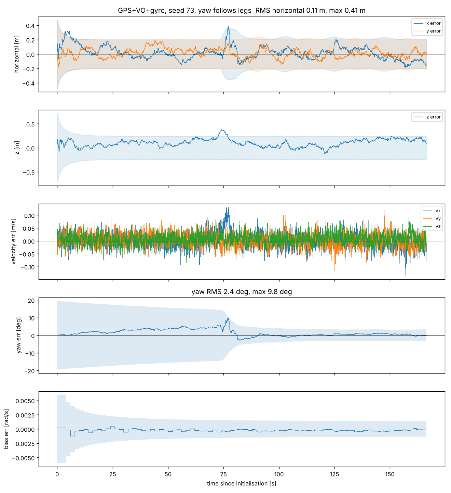
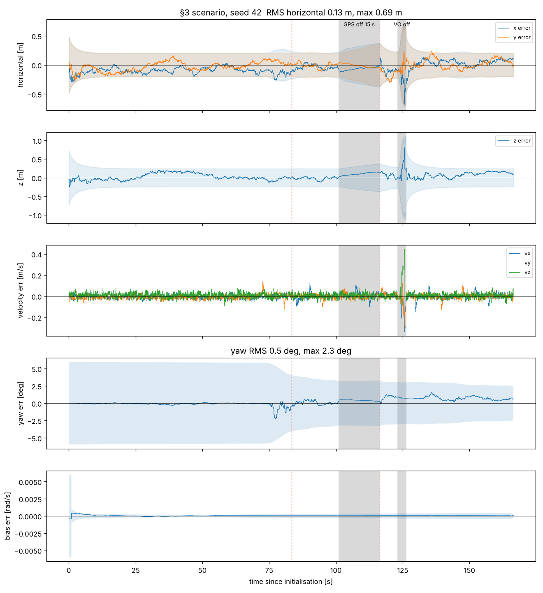

# drone_localization — Assignment 2, drone localisation

> **Estimate output:** `/localization/estimate` (`nav_msgs/Odometry`), frame
> **`map`** (ENU), child `base_link`. It carries x, y, z, a yaw quaternion,
> covariance from P, and a body-frame twist. The full state with standard
> deviations is on `/localization/estimate_state` (`std_msgs/Float64MultiArray`:
> `[t, px, py, pz, vx, vy, vz, yaw, b, σ_px … σ_b]`, ENU).

An eight-state EKF that fuses noisy GPS, drifting visual odometry and a biased
yaw-rate gyro from `localization_sensor_sim`. This README grows with each
increment; the full design document follows at the end.

| Increment | Status |
|---|---|
| 1. Sensor acquisition and characterisation (§1) | **done** |
| 2. EKF core: predict + GPS | **done** |
| 3. Yaw, gyro bias, VO updates | **done** |
| 4. ROS estimator node + evaluator | **done** |
| 5. Outages, outlier gating (§3) | **done** |
| 6. Flight on the estimate (§4): separate package `localization_flight` | **done** (sim-tested) |
| 7. Documentation | – |

## Code structure

```
drone_localization/
  include/drone_localization/ekf.hpp   Ekf: 8-state EKF. predict(), one generic gated
                                       Joseph-form update() and the four measurement
                                       models (position, velocity, body velocity, bias)
  include/.../localizer.hpp            Localizer: initialisation, measurement timing,
                                       GPS / VO / ZARU / ZUPT updates, sensor-loss logging
  src/estimator_node.cpp               ROS wrapper: parameters, subscriptions, publishing
  src/sensor_check_node.cpp            §1 live sensor check
  src/ekf_replay.cpp                   offline replay of a CSV event stream (same Localizer)
  test/test_ekf.cpp                    unit tests (EKF maths, timing, §3 robustness)
  config/estimator.yaml                every parameter, commented
  drone_localization_tools/            Python: bag reading, analysis, simulation, replay
  scripts/                             characterisation, evaluation, recording, flight
```

The core reuses library code instead of local helpers:

- logging: `rclcpp::Logger` with `RCLCPP_*`;
- angle wrapping: `angles::normalize_angle` and `shortest_angular_distance`;
- quaternions: `tf2::getYaw`, `tf2::Quaternion` and `tf2::toMsg`;
- message stamps: `rclcpp::Time`;
- linear algebra: Eigen (`LDLT`).

The numerics are unchanged by the simplification: Joseph-form covariance
update, LDLT solve of S, symmetrised P, and non-finite results refused (the
previous state is kept). A regression replay of 8 simulated runs (343,000
filter steps, with outages and outliers) gave bit-identical output before and
after the rewrite.

All χ² gates use 99.9 %: `gate_chi2_1dof` (10.83) for the gyro-bias
measurements, `gate_chi2_3dof` (16.27) for GPS, VO velocity and ZUPT.

## Build

From the workspace root (`ros2_ws`):

```bash
colcon build --packages-select drone_localization
source install/setup.bash
```

`localization_sensor_sim` lives at the course repository root. Build it once
into the same workspace so `ros2 launch` and the offline simulator can find it:

```bash
colcon build --base-paths src ../localization_sensor_sim \
  --packages-select localization_sensor_sim drone_localization
```

## §1 Sensor acquisition and characterisation

### Bring-up (repository root, separate terminals)

```bash
GZ_SIM_RESOURCE_PATH="$PWD/models:${GZ_SIM_RESOURCE_PATH:-}" \
  gz sim -r -v 4 --seed 42 "$PWD/worlds/fei_lrs_gazebo_localization.world"
scripts/run_sitl.sh
scripts/run_mavros.sh
ros2 launch localization_sensor_sim localization_sensors.launch.py seed:=42
```

### Live check: `sensor_check_node`

```bash
ros2 launch drone_localization sensor_check.launch.py
```

It subscribes to `/localization/{gps,vo,imu}` with `SensorDataQoS` and prints
a report every `window_s` (default 10 s) of **simulation** time. The window is
measured on IMU stamps, so it holds the same amount of data at any real-time
factor. Our Gazebo runs at about 0.09× real time, so one report arrives about
every 2 minutes of wall time. Each report shows:

- the rate from **header stamps** (simulation time) and from arrival time;
- frame checks: GPS `map`, VO `vo_odom` → `base_link`, IMU `base_link`;
- duplicate or out-of-order stamps, and the largest gap;
- truth-free corruption evidence while the drone is still: GPS std (noise),
  mean gyro Z (bias), VO displacement over the window (drift).

It never subscribes to ground truth or MAVROS localisation.

- the real-time factor of that window.

A first live run on seed 42 showed every stream at its nominal stamp rate
(5 / 30 / 100 Hz), no frame errors and no out-of-order stamps. The gyro Z mean
at rest was **−0.017 rad/s** (−1.0°/s). Gazebo draws the bias sign at random,
so it is negative here although the world's `bias_mean` is +0.02.

Quick manual checks:

```bash
ros2 topic hz /localization/imu
ros2 topic echo --once /localization/vo --field child_frame_id
```

### Recording and plots

1. Start recording in `ros2_ws/rosbags/`, which is git-ignored:
   `cd rosbags && ros2 run drone_localization record_characterisation.sh char_seed42`
2. Fly the open-loop characterisation profile:
   `ros2 run drone_localization characterisation_flight.py --ros-args -p use_sim_time:=true`.
   This is 20 s on the ground, takeoff to 2 m, 15 s hover, a 3 m square at
   0.5 m/s, then ±180° yaw turns and landing. It uses timed velocity setpoints
   only, with no position feedback. It is a characterisation tool, not part of
   the submitted controller.
3. Stop the recording after `landed and disarmed`.
4. Analyse:

```bash
ros2 run drone_localization characterize_sensors.py char_seed42
```

This writes `rates.png`, `gps_noise.png`, `vo_drift.png`, `gyro_bias.png`,
`trajectory.png` and `summary.json`. Ground truth is read from the bag
**offline only**, to measure the errors.

### Seed comparison

Repeat with a second seed (Gazebo `--seed 73` **and** `seed:=73` for the sensor
launch), and once more with seed 42. Then:

```bash
ros2 run drone_localization characterize_sensors.py char_seed42 --compare char_seed73
ros2 run drone_localization characterize_sensors.py char_seed42 --compare char_seed42b
```

- **Same seed:** identical hidden biases (gyro bias, VO body-velocity bias and
  scale) and a GPS error sequence with correlation ≈ 1.
- **Different seed:** a different gyro bias and VO bias, and GPS error
  correlation ≈ 0.

The GPS sequence only matches if no truth message was dropped between runs.
The hidden biases are drawn first, so they match regardless.

### Offline simulator (no Gazebo)

`drone_localization_tools.sim` drives the course's own
`sensor_model.SensorCorruptor` with a synthetic trajectory, plus a Gazebo-like
biased gyro. It's used to develop and regression-test the estimator. Expected
characterisation from simulated seed 42 / 73:

| | seed 42 | seed 73 |
|---|---|---|
| GPS std x/y/z [m] | 0.60 / 0.60 / 0.91 | 0.58 / 0.58 / 0.88 |
| VO drift | 1.10 m in 104 s, yaw −4.5° | 0.91 m in 104 s, yaw +2.8° |
| gyro Z bias | −0.028 rad/s (−1.6°/s) | +0.018 rad/s (1.0°/s) |

(The simulator's gyro RNG is not Gazebo's, so real-run biases differ.)

## Estimator core (increment 2)

```
include/drone_localization/ekf.hpp        8-state EKF: predict, generic gated Joseph update
include/drone_localization/localizer.hpp  initialisation, timing, per-sensor stats, logging
src/ekf_replay.cpp                        CSV replay of a sensor stream through Localizer
test/test_ekf.cpp                         gtests
```

The core is C++17/Eigen (it uses only `rclcpp` logging and `angles` from ROS),
so the ROS node, the offline replay and the unit tests all run the same code.

*This section and the following ones are a development log: values quoted
there are the ones tuned at that step. The current values are in
`config/estimator.yaml` and in "Code structure" at the top.*

**State** (ENU `map`): `x = [px py pz vx vy vz yaw b]`, where `b` is the gyro Z
bias (true yaw rate = `gyro_z − b`).

**Prediction** runs on every IMU message, using the dt between header stamps:

| | model | process noise |
|---|---|---|
| p, v | constant velocity | white acceleration, `accel_xy` = 0.5, `accel_z` = 0.3 m²/s³ |
| yaw | `yaw += (gyro_z − b)·dt`, wrapped | gyro σ = 0.004 rad/s per 100 Hz sample |
| b | random walk | `bias_walk` = 1e-4 rad/s/√s |

The yaw/bias Jacobian `∂yaw/∂b = −dt` is what lets yaw measurements correct
the bias later.

**GPS update:** `h(x) = p`, with R taken from the message covariance. It uses
the Joseph form and a χ² gate: 16.27 = 3 DOF at 99.9 %.

**Timing.** Every measurement is applied at its own header stamp. When a stamp
is ahead of the filter, the filter is predicted to that stamp with the last
gyro rate, then updated. A stamp up to `max_measurement_lag` (0.05 s) behind
the filter is applied at the filter time. Anything older is dropped and
counted as `dropped`. An IMU sample at or before the filter time
is never integrated twice.

**Initialisation** uses data only, never truth:

- position is the component-wise **median** of the first 10 GPS fixes, which is
  robust to an injected outlier, with variance (π/2)·σ²/n;
- yaw is the configured initial ENU yaw (π/2), σ = 10°;
- v = 0, σ = 0.2 m/s;
- bias is the **mean gyro Z collected on the ground** before the 10th fix, with
  σ = its standard error (floored at 0.003 rad/s). This assumes the drone is
  at rest when the estimator starts; the filter keeps refining the bias later.

### Tests and offline evaluation

```bash
colcon test --packages-select drone_localization --event-handlers console_direct+
ros2 run drone_localization evaluate_replay.py --sim 42 --sim 73 --sim 7
ros2 run drone_localization evaluate_replay.py --bag rosbags/char_seed42   # real run
```

`evaluate_replay.py` sends the sensor stream through the `ekf_replay` binary
(the same `Localizer`) and scores it against truth afterwards. It writes
error-vs-time plots with the filter's own ±2σ bands. Filter parameters can be
overridden as `key=value`, for example `accel_xy=0.8`.

GPS + gyro only, simulated §4 mission, five seeds:

| metric | result |
|---|---|
| horizontal RMS / max | 0.48–0.54 m / 1.2–1.6 m |
| z RMS | 0.41–0.50 m |
| yaw RMS | 0.5–2.3° (rests on the ground bias estimate only) |
| velocity RMS | 0.55–0.63 m/s, poor: GPS alone barely observes velocity |
| errors within 2σ | 0.95–1.00, so the covariance is consistent |

Yaw and bias are **unobservable** with GPS alone, so their uncertainty keeps
growing. Increment 3 adds the VO yaw and body-velocity updates.

## VO updates, yaw and gyro bias (increment 3)

Each VO message (30 Hz) triggers two updates.

**1. Body velocity, a genuine EKF update.** VO reports velocity in
`base_link`, so the measurement model rotates the world velocity by the
*estimated* yaw:

```
h(x) = [  cos(yaw)·vx + sin(yaw)·vy ]      ∂h/∂yaw = [ −sin·vx + cos·vy ]
       [ −sin(yaw)·vx + cos(yaw)·vy ]                [ −cos·vx − sin·vy ]
       [  vz                        ]                [  0               ]
```

The yaw column couples VO with GPS. While the drone moves horizontally, GPS
says which way it travels in `map`, and VO says which way it travels in the
body frame. Together they make **absolute yaw observable**. `test_ekf` checks
the Jacobian against finite differences on 20 random states.

R uses σ = max(message σ, **0.2 m/s**). That is far above the per-sample noise
(0.03 m/s) on purpose. VO's velocity bias (about 0.01 m/s) and scale error are
*correlated* over time, but the filter treats VO samples as independent. At
σ = 0.05 the filter was overconfident (only about 55 % of position errors
within 2σ) and *less* accurate, because VO's bias dragged the position. At 0.2
it is both the most accurate setting and consistent.

**2. VO yaw, used as a relative measurement of the gyro bias.** Every
`vo_yaw_window` (2 s) the filter compares how far the gyro says the drone
turned with how far VO saw it turn:

```
b_meas = ( ∫gyro dt − wrap(ψ_vo(t) − ψ_vo(t−T)) ) / T
```

This directly measures the bias, without involving the yaw state. Its variance
is (√2·0.3°/T)² from VO pose noise, plus the gyro noise, plus a
`vo_yaw_rate_sigma` (0.001 rad/s) allowance for VO's own yaw-rate drift. The
gyro integral is evaluated exactly at the VO stamps.

**Why absolute VO yaw is not fused** (tested during development, then removed). The
`vo_odom` frame starts aligned with `map`, but its yaw drifts (random walk
plus a rate bias) from the moment the sensor simulator starts. The idle time
before takeoff decides how far it has drifted. With 60 s of idle time, fusing
it put the yaw error within 2σ only 48–69 % of the time. The relative form
only needs VO to be good over 2 s, and that holds.

**VO position is not fused either.** It is the integral of the same velocity
signal (so it would repeat that information) and drifts about 0.6 m/min.

### Observability, as seen in the data



- **On the ground and hovering (first 75 s):** the relative update finds the
  bias within about 0.0003 rad/s. Nothing observes absolute yaw yet, though, so
  yaw creeps a few degrees off (VO's own yaw-rate drift leaks into the bias
  measurement). The filter knows: the yaw 2σ band stays about ±15°.
- **First horizontal leg:** the velocity coupling makes yaw observable. It
  locks to within about 1°, and the band shrinks to about ±3°.
- The **worst-case yaw error, about 8–10°**, comes from this pre-flight creep,
  just before the first leg corrects it.

### Results (simulated §4 mission, 8 seeds, 60 s idle, bias *not* known)

| metric | GPS only | **GPS + VO + gyro** |
|---|---|---|
| horizontal RMS (in flight) | 0.49 m | **0.13–0.15 m** (max 0.49 m) |
| z RMS | 0.45 m | **0.12–0.13 m** |
| velocity RMS | 0.57 m/s | **0.045 m/s** |
| yaw RMS in flight | — (bias unknown: 53–71°) | **1.5–2.1°** |
| gyro bias error at end | not observable | **0.0003 rad/s** |
| errors within 2σ (x,y / z / yaw) | | **0.95–0.97 / 0.94 / 0.94–1.00** |

"Bias not known" means the filter started without the ground gyro mean (no
gyro data before initialisation), the hardest case. The default (bias from the
ground gyro mean) only shortens the transient.

Reproduce with:

```bash
ros2 run drone_localization evaluate_replay.py --sim 42 --sim 73 --yaw-follow
ros2 run drone_localization evaluate_replay.py --sim 42 --sensors imu,gps        # GPS-only baseline
ros2 run drone_localization evaluate_replay.py --sim 42 vo_velocity_sigma=0.05   # overconfident
```

## ROS estimator node (increment 4)

```bash
ros2 launch drone_localization localization.launch.py                  # estimator only
ros2 launch drone_localization localization.launch.py evaluator:=true  # + truth evaluator
```

### `estimator_node`, node name `localization_estimator`

| | |
|---|---|
| subscribes | `/localization/gps`, `/localization/vo`, `/localization/imu`, with `SensorDataQoS`. **Nothing else.** |
| publishes | `/localization/estimate` (Odometry, `map` → `base_link`, 100 Hz, stamped with the filter time) and `/localization/estimate_state` |
| parameters | `config/estimator.yaml`: every Q, R, P0, gate and timing value, each commented |
| executor | single-threaded, so the callbacks never touch the filter concurrently |

- **Thin wrapper.** The node only converts messages and calls the `Localizer`.
  The ROS node, `ekf_replay` and the gtests therefore all run the same filter
  code.
- **Frame checks.** A message with an unexpected `frame_id` or
  `child_frame_id` is ignored, with a throttled warning.
- **Odometry twist** follows the ROS convention, so it is in `base_link`.
  `angular.z` = gyro − estimated bias.
- **Logging is rate-limited.** A status line appears every 5 s of sim time:
  state ± σ, bias, and accepted/rejected counts per sensor. Every rejection
  and every lifecycle event is also logged, but nothing is logged at sensor
  rate.
- **A Gazebo reset is detected.** If sim time jumps back more than 1 s, the
  filter is re-initialised. That is the only case in which it ever restarts.
- **No TF is broadcast**, because MAVROS already publishes `map → base_link`.

### Truth-only evaluator (separate process)

`estimate_evaluator.py` subscribes to `/evaluation/ground_truth` and
`/localization/estimate_state`. It logs errors every 5 s and publishes
`/evaluation/estimate_error` (`[t, ex, ey, ez, evx, evy, evz, eyaw]`, for
rqt_plot or PlotJuggler). On Ctrl-C it writes `evaluation/estimate.csv`,
`truth.csv` and `errors.png`. It publishes nothing the estimator or
controller subscribes to:

```bash
ros2 node info /localization_estimator      # proves the estimator's inputs
ros2 topic info -v /evaluation/ground_truth # only the evaluator subscribes
```

### Live check (no flight needed)

With Gazebo, SITL, MAVROS and the sensor launch running:

```bash
ros2 launch drone_localization localization.launch.py evaluator:=true
```

Expect `initialised at t=…` about 2 s of sim time after start, then a status
line every 5 s of sim time.

### Replaying a bag into the live node (no Gazebo or ArduPilot)

```bash
ros2 launch drone_localization localization.launch.py evaluator:=true
ros2 bag play rosbags/char_seed42 --clock \
  --topics /localization/gps /localization/vo /localization/imu /evaluation/ground_truth
```

### Scoring a recorded run

`record_characterisation.sh` also records the estimate. Afterwards:

```bash
ros2 run drone_localization evaluate_replay.py --bag rosbags/run1 --recorded  # what the node published
ros2 run drone_localization evaluate_replay.py --bag rosbags/run1             # replay through ekf_replay
```

The two should agree, which is a check that the node and the offline replay
behave the same.

## Changes after the first live run (increment 4 → 5)

The live run on seed 42 (estimator started about 490 s of sim time after the
simulator) showed horizontal RMS 0.14 m with 92–100 % of errors within 2σ. It
also exposed two problems.

1. **A startup spike in the relative VO yaw measurement (bug).** The gyro
   integral had stamp 0 until the first IMU sample after initialisation, so the
   first measurement extended the integral over 493 s (2.96 rad/s, NIS 375 641;
   rejected by the gate). It is fixed, and a regression test
   (`RelativeVoYawAtLargeSimTimeHasNoStartupSpike`) now starts at t = 493 s.
2. **Yaw crept about 2.5° in 45 s on the ground.** VO's yaw-rate drift is a
   random walk that starts with the simulator, so after about 490 s it was
   about 0.0015 rad/s. It is *constant* over a flight and does not average out,
   and the relative measurement had pulled the bias by exactly that much.
   Three changes:
   - **Zero-angular-rate update (ZARU).** While the *estimate* says the drone
     rests on the ground (within 0.25 m of the initial height, speed
     < 0.15 m/s), the true yaw rate is 0. Each 1 s gyro mean is then a direct
     bias measurement (σ = 0.004/√100 ⊕ 2e-4 rad/s). This uses only estimator
     inputs: MAVROS "landed" state is off-limits to the estimator.
   - `vo_yaw_rate_sigma` 0.001 → **0.005**: the relative VO measurement is now
     a weak fallback, for when there is no ground phase.
   - `init_yaw_sigma` 10° → **3°**: the spawn heading is known. With a loose
     prior, the first noisy velocity comparisons on leg 1 pushed yaw around by
     up to 9°.

   Effect (simulated, 12 runs): **500 s idle** before takeoff, yaw error at
   takeoff **17° → 0.2°**, yaw within 2σ 0.68 → 0.99. **60 s idle**, worst
   in-flight yaw 9.8° → 3.1°.

The evaluator also gets 30 s to save on Ctrl-C (`sigterm_timeout`), and
matplotlib is imported at start-up so saving is quick.

### Second live run (after the ZARU fix)

Live on seed 42, about 690 s after simulator start: yaw held at 90.1°, with
bias −0.0170 ± 0.0001 rad/s. The §3 services behaved as designed: `GPS LOST`,
then `GPS RECOVERED after 12.6 s`, then the outlier on the first fix after
recovery was rejected (`NIS 62.0 > gate 16.27 … 5.51 m [first fix after
outage]`). Two refinements followed:

- **The resting detector flapped** (6 transitions in 5 s). The initial height
  came from noisy GPS z (+0.32 m), right at the old 0.25 m threshold. It now
  has **hysteresis**: enter after 1 s with height < 0.3 m and speed < 0.1 m/s;
  leave at > 0.4 m or > 0.25 m/s. Its height reference follows the converged
  estimate while resting. Simulated: exactly 3 transitions per run (rest,
  takeoff, landing).
- **About 0.25 m horizontal offset at rest.** VO's *velocity* bias is also a
  random walk from simulator start (≈ 0.02 m/s after 690 s) and drags the
  position. While resting, a **zero-velocity update (ZUPT)** fuses v = 0
  (σ 0.03 m/s), gated at χ²(3) 99.9 %. A real takeoff fails the gate, which
  ends "resting" immediately, so the ZUPT can never pin a climb (unit test
  `ZeroVelocityUpdateDoesNotPinTakeoff`; takeoff is detected 0.5–0.7 s after
  the climb starts). In flight the VO velocity bias cannot be separated
  without extra states (the state is fixed at 8), and the σ = 0.2 m/s VO
  weighting keeps its effect at 0.13–0.17 m RMS.

## Missing and bad measurements (§3, increment 5)

### Behaviour

| event | what the filter does | log (once per transition, never at sensor rate) |
|---|---|---|
| GPS stops | keeps predicting; position comes from VO velocity + motion model, P grows | `GPS LOST at t=…: no fix for 1.0 s …` |
| GPS returns | the first fix goes through the normal gate; correction through the Kalman gain, never a reset | `GPS RECOVERED … after 15.2 s` / `GPS re-acquired: first fix innovation …` |
| GPS outlier | χ² gate on `r' S⁻¹ r`, with `S = H P Hᵀ + R` | `GPS REJECTED at t=…: NIS 66.8 > gate 16.27 (chi2, 3 DOF), innovation … = 5.64 m` |
| 5 consecutive GPS rejections | the *estimate* is assumed to have drifted: position covariance is inflated to the disagreement, so the next fixes pass and pull it back gradually | `5 consecutive GPS rejections: … inflated position covariance …` |
| VO stops | velocity comes from GPS + motion model; the relative-yaw baseline restarts after the gap | `VO LOST …` / `VO RECOVERED …` |
| IMU gap | measurements predict with the last gyro rate | `IMU LOST …` / `IMU RECOVERED …` |
| NaN/Inf input or result | input ignored; a non-finite or non-positive-definite update is refused, and the previous valid state is kept | `… kept the previous valid state` |

Timeouts are in sim time (`gps_timeout` 1.0 s, `vo_timeout` 0.3 s,
`imu_timeout` 0.1 s). They only drive logging and the VO yaw baseline. The
filter itself never freezes or resets.

### Gate threshold

`gate_chi2_3dof = 16.27` is χ² with 3 DOF at 99.9 %: a correct fix is rejected
1 time in 1000, about once per flight, and the cost is one skipped fix. The
injected outlier is 5–8 m in a **random 3D direction**. The hardest case is
vertical, where GPS σ is 0.9 m. Over 60 simulated outliers, including ones
arriving as the first fix after a 15 s outage, the **smallest NIS was 22.5**
(5th percentile 31.8, median 73). 99.99 % (21.11) would leave almost no
margin, so 99.9 % it is.

### Simulated §3 scenario (16 runs: 8 seeds × fixed/turning heading)

GPS off for 15 s during lap 2, an outlier requested **during** the outage (so
it lands on the first fix after recovery, as the sensor simulator does), an
outlier mid-lap 1, and VO off for 3 s:



| | mean | worst |
|---|---|---|
| horizontal error before the outage | 0.18 m | 0.25 m |
| horizontal error during the 15 s GPS outage | 0.28 m | 0.57 m |
| largest 10 ms step of the estimate at GPS recovery | 0.11 m | 0.15 m |
| horizontal error during the 3 s VO dropout | 0.55 m | 0.69 m |
| outliers rejected | **32 / 32** (16 mid-flight, 16 first-after-outage) | |
| false GPS rejections | 10 in 16 runs, about 0.6 per flight | |
| whole-run horizontal RMS | 0.17 m | 0.24 m |

`accel_xy` 0.5 → **0.1** and `accel_z` 0.3 → **0.1** came from this scenario.
With VO gone, a loose motion model let GPS noise drive the velocity. Worst
horizontal error in the dropout fell from 0.91 to 0.69 m, vertical from 0.84 to
0.64 m. Nominal accuracy was unchanged or slightly better.

Nominal flight with the final defaults (16 runs, 60 s idle): horizontal RMS
**0.14 m**, z RMS **0.12 m**, yaw RMS **0.9°** (worst 4.1°), velocity RMS
**0.04 m/s**, bias error **7e-5 rad/s**; within 2σ: xy 0.96, z 0.94, yaw 0.96.

Unit tests for §3 (`test_ekf`, `Section3.*`): a 15 s GPS outage stays finite
and recovers without a jump; a VO dropout is carried by GPS; a vertical 5 m
outlier is rejected even as the first fix after an outage; consecutive
rejections re-acquire GPS; NaN inputs are ignored. **22/22 pass** (including
the resting-detector test).

### Testing it live (teacher's services)

```bash
ros2 service call /localization/set_gps_enabled std_srvs/srv/SetBool "{data: false}"
# … 15 s of sim time …
ros2 service call /localization/set_gps_enabled std_srvs/srv/SetBool "{data: true}"
ros2 service call /localization/inject_gps_outlier std_srvs/srv/Trigger
ros2 service call /localization/set_vo_enabled std_srvs/srv/SetBool "{data: false}"
ros2 service call /localization/set_vo_enabled std_srvs/srv/SetBool "{data: true}"
```

## First live flight and follow-up (increment 6)

The first live mission, launched about 875 s after simulator start, showed:

- **The flight node aborted at takeoff** with `FCU left GUIDED (mode )`.
  MAVROS had briefly published an **empty** mode (a missed heartbeat at 0.09×
  real time). ArduPilot itself stayed in GUIDED and completed the climb.
  Fixed in `localization_flight`: an empty mode or a lost link is "unknown"
  and the node keeps flying; only a real other mode held for 1.5 s aborts.
  Every MAVROS state change is now logged.
- **Only 1 s on the ground before arming**, so the gyro bias rested on about
  2 s of gyro data. While hovering (yaw unobservable) yaw drifted about 2° in
  2 min. The flight node now **settles ≥ 15 s on the ground**, until the
  estimator's bias σ (published in `twist.covariance[35]`) is below
  2.5e-4 rad/s, before it captures the origin and arms.
- **The estimator behaved as designed through the teacher-style test.** GPS
  was lost, recovered after 12.8 s, and the 6.8 m outlier on the first fix
  afterwards was rejected (NIS 118 > 16.27). The error grew 0.38 → 0.68 m
  during the outage: VO's velocity bias after about 900 s of simulator uptime
  is around 0.025 m/s. Raising **`vo_velocity_sigma` 0.2 → 0.3** restores
  covariance consistency in that regime. Simulated with 900 s idle, the 2D 95 %
  region held 85 → 96 % of errors, and accuracy improved slightly (flight
  horizontal RMS 0.20 → 0.19 m). With 60 s idle it is equal or better (within
  2σ xy 0.96 → 0.99).

**Tip for the defence:** VO's hidden biases random-walk from the moment the
sensor simulator starts. Start the sensor launch shortly before the mission,
rather than leaving it running for a long time, to get the best estimate.
